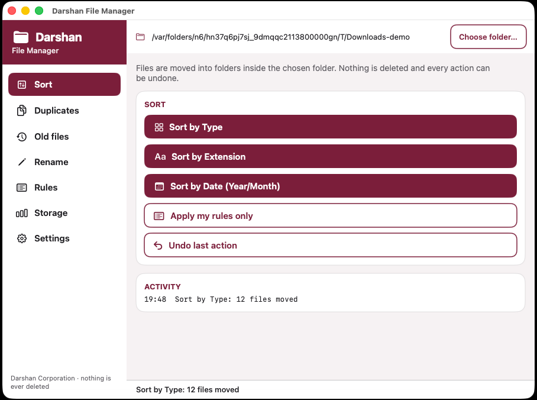
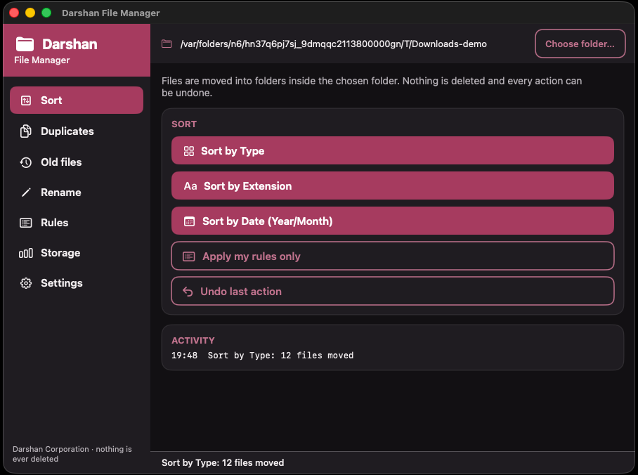
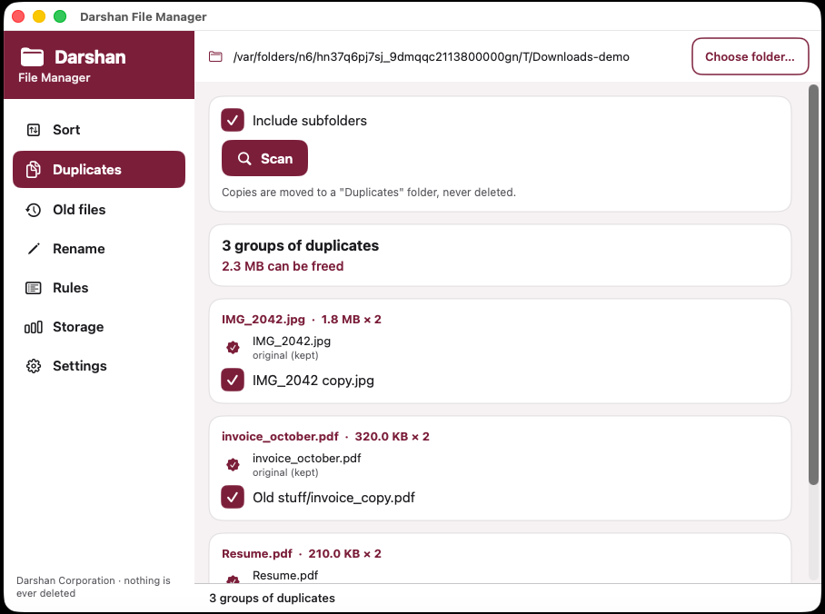
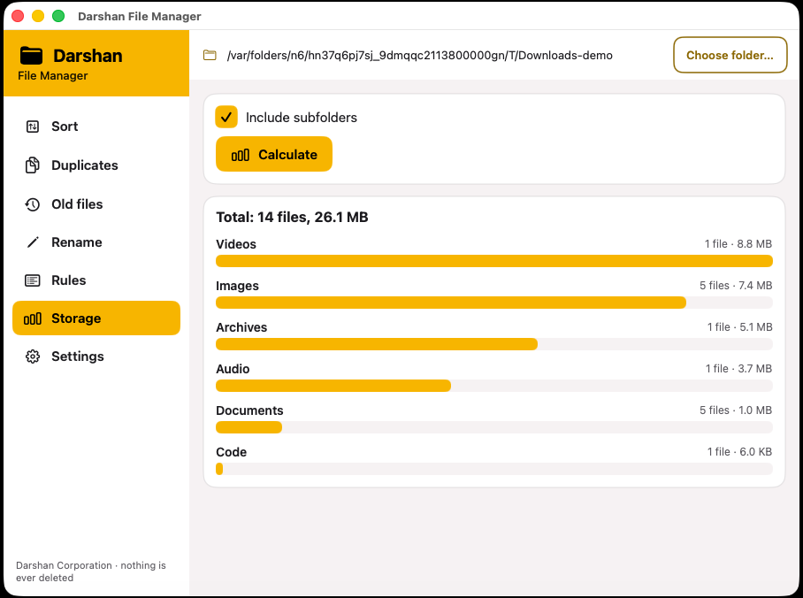
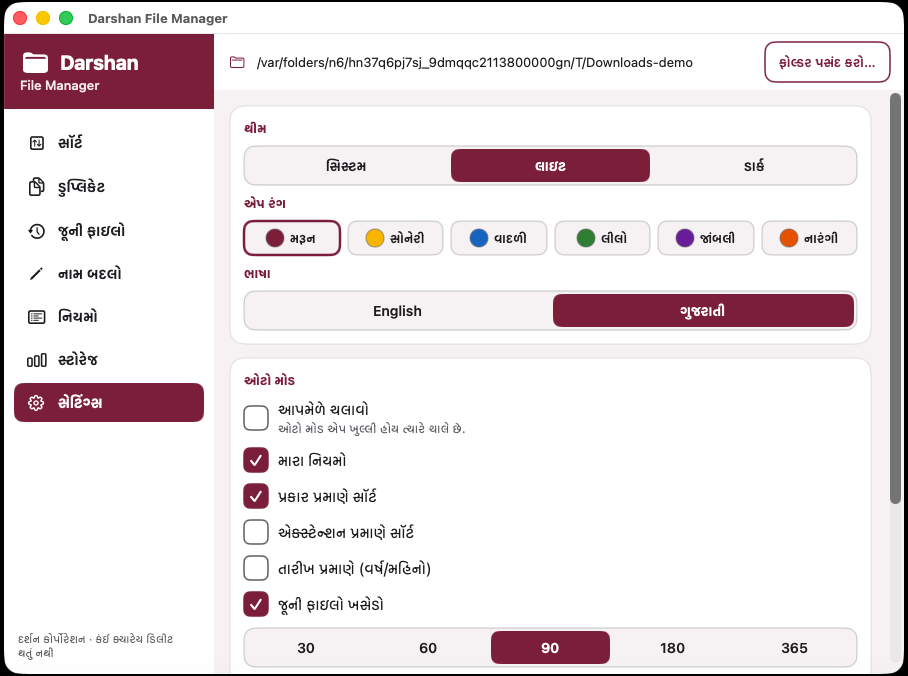
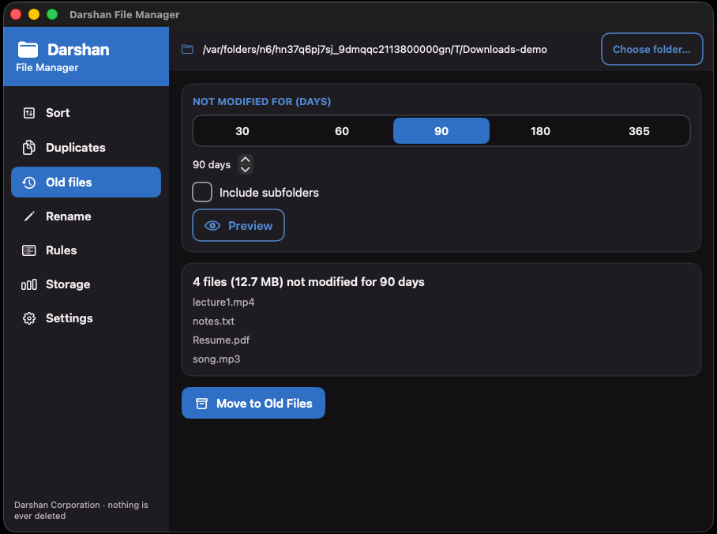

<p align="center">
  
</p>

<h1 align="center">Darshan File Manager for macOS</h1>

<p align="center">
  Keep any folder tidy: sort by type, extension or date, find duplicates, clear old files, batch rename, your own rules — with Undo for everything. English and ગુજરાતી, light / dark / system theme and six accent colours.
</p>

<p align="center">
  
  
  
  
</p>

---

## ✨ Features

| | Feature | What it does |
|---|---|---|
| 🗂 | **Sort by Type** | `Images`, `Videos`, `Audio`, `Documents`, `Archives`, `Code`, `Others` |
| 🔤 | **Sort by Extension** | One folder per extension (`JPG`, `PDF`, `MP4`, …; `.tar.gz` handled) |
| 📅 | **Sort by Date** | `Year/MM-Month` folders from the modified date, e.g. `2026/11-November` |
| 👯 | **Duplicate finder** | Same size, then SHA-256; shows the space you can free; moves copies to `Duplicates` — **never deletes**, always keeps one original |
| 🧹 | **Old files cleaner** | Files not modified for 30 / 60 / 90 / 180 / 365 / custom days → `Old Files`, with a preview first |
| ✏️ | **Batch rename** | Filter by name / extension, prefix, suffix, find → replace, numbering (`Photo_001`), preview before applying |
| 🧩 | **My rules** | "extension is jpg, png" or "name contains invoice" → any folder, applied **before** the built-in types (first match wins) |
| 📊 | **Storage usage** | Count and size per category as a bar chart |
| ↩ | **Undo** | Every action (sort, duplicates, old files, rename, auto run) can be undone; the undo history survives restarts |
| ⏱ | **Auto mode** | Tick what runs automatically (rules, type / extension, date, old files, duplicates) + notification such as *“12 sorted, 3 duplicates moved, 5 old files moved”* |
| 🎨 | **Themes** | Light / Dark / System and accent colours Maroon (default), Gold, Blue, Green, Purple, Orange — checked for readable contrast |
| 🌐 | **Language** | English / ગુજરાતી, switches immediately |

### Safe by design
- Never overwrites: a name clash becomes `file (1).jpg`.
- Never deletes anything. Duplicates and old files are *moved* into folders inside the folder you chose.
- Skips hidden files, system files and files that are still downloading (`.crdownload`, `.part`, `.tmp`).
- Refuses to run on the disk root or system folders in Auto mode.
- No internet, no accounts, no telemetry.

## 📸 Screenshots








Screenshots are produced by the CI build itself (the real app, launched in demo mode with a sample folder).

---

## ⬇️ Download & install

1. Download **[`DarshanFileManager-macOS.zip`](https://github.com/DARSHAN-CROP/Darshan-File-Manager-macOS/raw/main/release/DarshanFileManager-macOS.zip)** (universal: Apple Silicon + Intel).
2. Unzip it and drag **Darshan File Manager.app** to *Applications* (or anywhere you like).
3. The app is **not notarized** (no paid Apple developer account), so the first time: **right-click the app → Open → Open**.
   If macOS still refuses, run once in Terminal: `xattr -cr "/Applications/Darshan File Manager.app"`
4. Choose a folder (for example *Downloads*) and click **Sort by Type**.

Requires macOS 13 Ventura or newer.

---

## ✅ How it was tested (please read)

- The logic lives in a plain Swift package, **DarshanCore**, with **72 XCTest unit tests**: sorting by type / extension / date, rule precedence, duplicate grouping and moving, old-file selection, rename patterns, storage totals, undo, theme contrast, Gujarati strings and Auto-mode summaries.
- Every push is built and tested by **GitHub Actions on a real macOS runner** (see the **Actions** tab). The CI also builds the universal `.app` bundle and ad-hoc signs it.
- **It has not been tested on a physical Mac by the author** (the author does not own one). CI screenshots show the real app running, but if you hit a bug, please open an issue.

## 🛠 Build from source

```bash
git clone https://github.com/DARSHAN-CROP/Darshan-File-Manager-macOS.git
cd Darshan-File-Manager-macOS
swift test                      # core unit tests (also run on Linux)
./scripts/make_app.sh            # builds build/Darshan File Manager.app + zip
```

Project layout:
- `Sources/DarshanCore` – file logic (Foundation only)
- `Sources/DarshanUI` – shared SwiftUI interface (macOS + iOS)
- `Sources/MacApp` – the macOS app shell
- `Tests/DarshanCoreTests` – unit tests

## 🔗 Sibling apps

- 🪟 Windows: [DARSHAN-CROP/Darshan-File-Manager-Windows](https://github.com/DARSHAN-CROP/Darshan-File-Manager-Windows)
- 🤖 Android: [DARSHAN-CROP/Darshan-File-Manager-Android](https://github.com/DARSHAN-CROP/Darshan-File-Manager-Android)
- 📱 iPhone: [DARSHAN-CROP/Darshan-File-Manager-iOS](https://github.com/DARSHAN-CROP/Darshan-File-Manager-iOS)

## 📄 License

MIT — © 2026 Darshankumar Savsani (Darshan Corporation)
